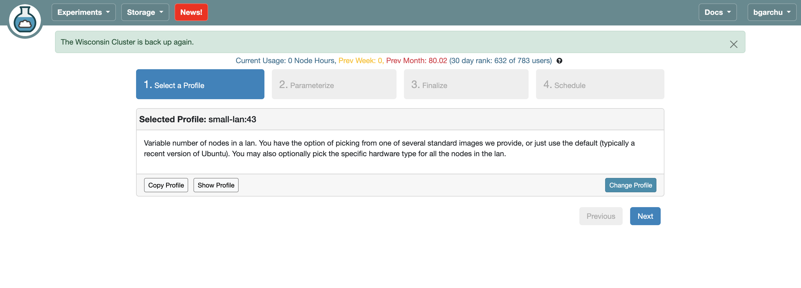
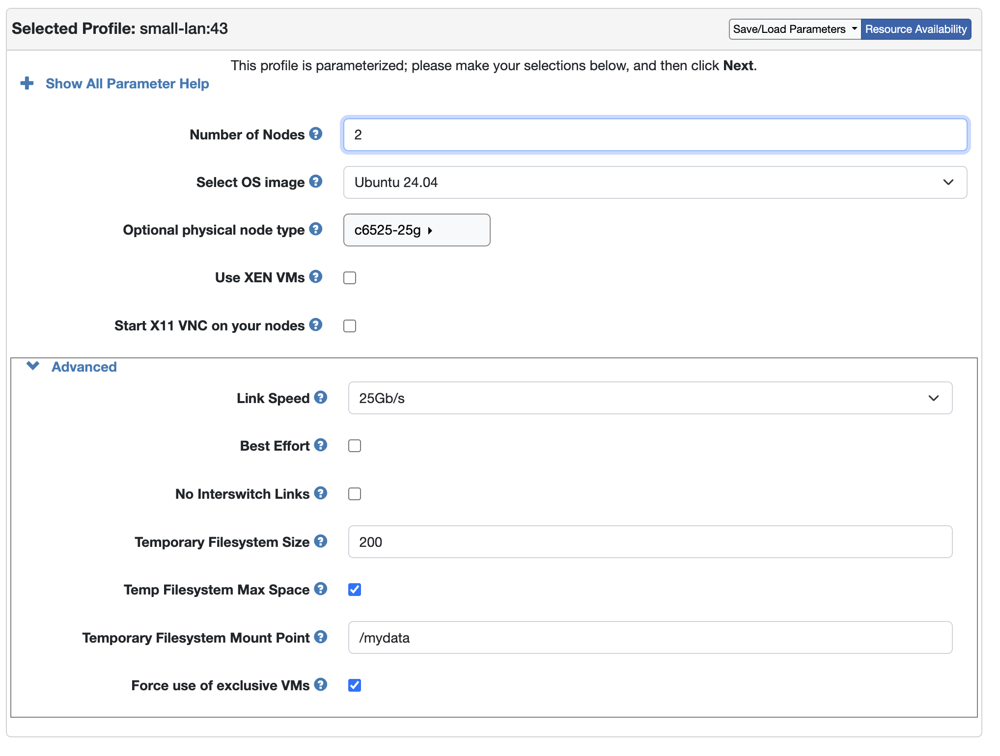

# MitraFSnap evaluation

This repository contains the benchmark suite we use to compare MitraFSnap with Docker,
eStargz and 2DFS. It measures how long each method takes to build an image, to pull it and
start a container, and to apply an update to a running service. The workloads are large
language models and a video analytics bundle with several vision models.

The suite uses the MitraFSnap [builder](https://github.com/mitrafsnap/builder),
[registry](https://github.com/mitrafsnap/registry) and
[snapshotter](https://github.com/mitrafsnap/snapshotter).

## Layout

```
benchmark/     build, pull and update experiments, shared helpers and configs
node-setup/    scripts that prepare the registry node and the client/builder node
split-llm/     splits an LLM checkpoint into separately packaged parts
util/          helpers to apply configs, prune caches, reset the registry and fetch model splits
docs/          screenshots for the CloudLab guide
```

## Benchmark setup

The benchmark runs on two CloudLab `c6525-25g` nodes
([spec](https://www.utah.cloudlab.us/portal/show-nodetype.php?type=c6525-25g)). One node
runs the registry, and the other runs both the builder and the client. Other servers work
as well, as long as the root folder `/mydata` exists.

## CloudLab guide
- go to experiments -> start an experiment
- pick a profile. In general profile doesn't matter because the hardware is defined separately. We use `small-lan` in our experiments.



- specify node type, OS, etc
- important to select "temp filesystem max space". In this case temporary filesystem size doesn't matter as CloudLab will allocate all available storage on that node



## About `/mydata`

The CloudLab root disk is too small for benchmark artifacts, so the benchmark lives on the `/mydata`
mount point allocated in the CloudLab profile. CloudLab can allocate up to 1TB into the mount point of user's choice.

- `/var/lib/containerd` and `/var/lib/containerd-stargz-grpc` are symlinked into `/mydata`
- `TMPDIR=/mydata/tmp`, buildkit root `/mydata/buildkit`
- 2dfs home dir - `/mydata/.2dfs`, `HF_HOME=/mydata/huggingface`
- registry storage in `/mydata/2dfs-registry-data`
- this repository in `/mydata/evaluation`

## Setup steps

### get registry ip - `10.10.1.2` by default (cloudlab)

```bash
hostname -I | awk '{print $2}'
```

### registry setup (run before client)

```bash
curl -Lo "${HOME}/registry-node-setup.sh" \
	https://raw.githubusercontent.com/mitrafsnap/evaluation/main/node-setup/registry-node-setup.sh

chmod +x "${HOME}/registry-node-setup.sh"
sudo "${HOME}/registry-node-setup.sh"
```

### combined node setup (client + builder)

- install kernel (stargz FUSE passthrough needs >= 6.9)
- the script reboots the machine, reconnect and continue after reboot

```bash
cd /mydata
sudo chown $USER /mydata
git clone https://github.com/mitrafsnap/evaluation.git
cd evaluation/
sudo ./node-setup/install-hwe-kernel.sh
```

- node setup script
- use correct registry ip and stargz-snapshotter implementation

```bash
cd /mydata/evaluation/node-setup
sudo ./combined-node-setup.sh 10.10.1.2 https://github.com/mitrafsnap/snapshotter.git
```

- env setup
- prepare `HF_TOKEN` with access to models used in the benchmark
```bash
cd ..
python3 -m venv .venv-benchmark
source .venv-benchmark/bin/activate
pip install -r ./benchmark/requirements.txt
echo "HF_TOKEN=..." > ./benchmark/.env
```

- benchmark uses `shared/config.yaml` by default. Copy desired config and adjust registry variable if needed.

```bash
cp /mydata/evaluation/benchmark/shared/config-cloudlab.yaml /mydata/evaluation/benchmark/shared/config.yaml 
```

- install the split-llm dependencies, use the specified venv name as it is later used in the benchmark 

```bash
cd /mydata/evaluation/split-llm
sudo apt install -y graphviz
python3 -m venv .venv-split-llm
source .venv-split-llm/bin/activate
pip install -r requirements.txt
```

- download CV model splits (optional)

```bash
cd /mydata/evaluation
./util/download-splits.sh
```

### Run the benchmark

`run-bg.sh` runs `run.py` in detached mode. Set `NTFY_TOPIC` for
push notifications on finish/failure.

```bash
cd /mydata/evaluation
source .venv-benchmark/bin/activate
cd benchmark
./run-bg.sh
```

Edit `run.py` to specify which benchmark phases you want to run.
Also make sure to adjust `EXPERIMENTS` in benchmark runners (i.e. `build_performance/measure.py`).
Results are written to `build_performance/{results,charts}/` and
`pull_performance/{results,charts}/`. 